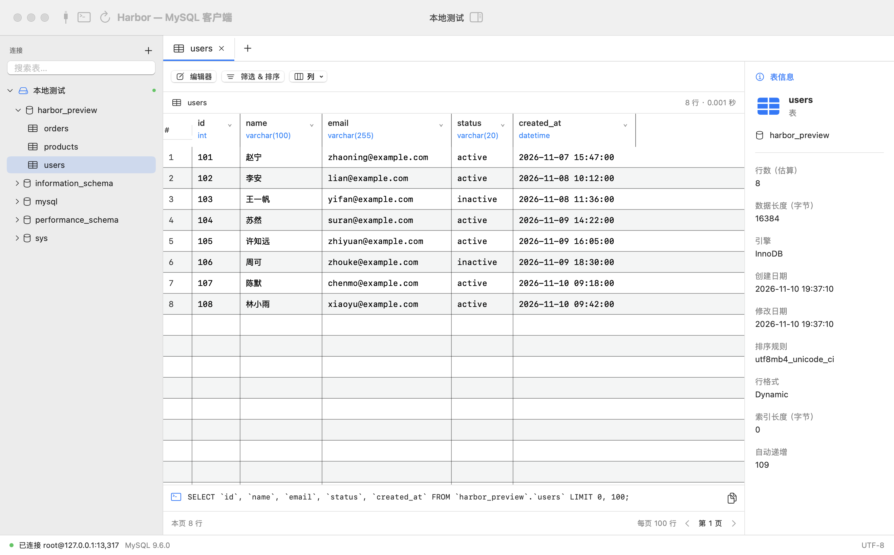

# Harbor

一个轻量、开源的原生 macOS MySQL 客户端。采用熟悉的连接树、数据表格和 SQL 标签布局，专注连接数据库、浏览和编辑数据以及日常查询。独立项目，与 Navicat 无关联。

Swift + SwiftUI + AppKit · MySQLNIO · MIT License



## 下载与使用

从 [Releases](https://github.com/miaodidi/harbor-mysql/releases) 下载 `Harbor-arm64.zip`，解压后将 `Harbor.app` 拖入“应用程序”。系统要求 **macOS 14+、Apple Silicon**。Intel Mac 可在本机从源码构建。

当前版本为 **v0.1.0 预览版**。安装包使用 ad-hoc 签名，尚未经过 Apple Developer ID 签名和公证；如果系统阻止首次打开，可在“系统设置 → 隐私与安全性”中允许打开，或自行从源码构建。

1. 点击“新建连接”，填写主机、端口、用户名和密码，可先测试再保存。
2. 在左侧双击连接；展开数据库，点击表名浏览数据。
3. 点击或右击任意表头，选择升序、降序或清除排序。
4. “筛选 & 排序”在服务器端执行条件；“列”控制显示字段。底部始终显示最近一次成功执行的完整 SQL，支持复制。
5. 点击单元格后打开“编辑器”，或双击单元格。保存时展示实际 UPDATE 语句供确认。
6. “新建查询”打开 SQL 标签，选择数据库后按 **⌘↵** 执行。**⌘S** 导出 SQL，**⌘R** 刷新。

## 第一版功能

- TCP/IP 连接，支持 `mysql_native_password` 和 `caching_sha2_password`。
- TLS 可关闭、要求加密，或加密并验证证书；选择加密后拒绝明文回退。
- 连接配置本地保存；密码存入 macOS 钥匙串，也可只在当前进程内保留。
- 数据库、表和视图浏览；多个数据表 / 查询标签。
- AppKit 原生表格、可调整列宽、每列排序菜单、单元格复制（⌘C）。
- 每页 100 行，服务器端筛选和排序，列显隐及实时 SQL。
- 右侧表信息：引擎、估算行数、大小、创建/修改时间、排序规则及自增值等。
- 有主键的表支持单个字段更新，按完整主键和原字段值定位，防止覆盖已变化的数据。
- 空结果保留表头，区分 NULL 和空字符串，二进制值显示为十六进制，保留 DECIMAL 精度。

## 范围与限制

- 当前同时保持一个活动连接。切换连接会关闭表标签，保留 SQL 草稿；SQL 草稿不会跨应用重启保存。
- 查询编辑器每次执行一条语句。INSERT / UPDATE / DELETE / DDL 可以在查询标签执行，修改前会确认；暂无表格内新增/删除行、批量编辑、自动补全、SQL 文件导入或 SSH 隧道。
- 无主键的表、视图、主键列、生成列、二进制列只读；隐藏主键列时禁用字段编辑。复合主键会全部参与定位。
- 单条 SQL 最多保留 10,000 行或 32 MiB 的结果，超出部分会标注。仍会读取并丢弃剩余网络数据以保持连接状态；耗时查询可取消，或在 30 秒超时后断开连接。
- 表信息的行数来自 `information_schema`，InnoDB 可能是估算值。分页大小为 100，最后一页恰好满页时，“下一页”可能显示空页。
- MySQL 协议目标为 5.7+；当前已在 MySQL 9.6 上验证。尚未逐版本验证 5.7 / 8.x，也未验证 MariaDB。

## 数据与隐私

配置位于 `~/Library/Application Support/Harbor/connections.json`，不包含密码。密码使用钥匙串 service `io.github.miaodidi.harbor.mysql` 保存。应用无遥测，不上传连接信息或查询结果；只连接你配置的数据库。生产环境建议使用最小权限账号。

## 开发

使用 **Swift 6.2+（Xcode 26+）** 的 Swift 工具链：

```sh
swift build
swift test
bash scripts/build-app.sh
open dist/Harbor.app
```

`scripts/build-app.sh` 生成原生 `.app` 和当前架构的 ZIP，默认使用 release 构建。`CONFIGURATION=debug bash scripts/build-app.sh` 可生成调试版。签名身份可通过 `HARBOR_SIGN_IDENTITY` 指定，默认 ad-hoc。

`swift test` 运行单元测试；没有设置测试服务器时，数据库集成测试明确跳过。针对独立的本地测试实例：

```sh
HARBOR_TEST_PORT=13317 HARBOR_TEST_USER=root swift test
```

测试会创建、使用并删除随机命名的测试数据库。验证 Unicode、引号/反斜杠、两种 SQL mode、NULL、BLOB、精确小数、空结果、分页、筛选、排序、字段修改冲突、超时重连和 TLS。可通过 `HARBOR_TEST_PASSWORD` 提供密码。

调试版支持显式开启的原生 UI 冒烟测试：先将 `scripts/preview-fixture.sql` 导入独立测试实例，然后运行：

```sh
HARBOR_TEST_PORT=13317 HARBOR_SMOKE_OUTPUT=/absolute/path/screenshot.png \
  "$(swift build --show-bin-path)/Harbor" --smoke-test
```

这个模式不保存配置或密码，并在检查完后退出。详见 [贡献指南](CONTRIBUTING.md)。

## 架构

- `Sources/Harbor`：SwiftUI 窗口、连接管理、查询和筛选界面；AppKit `NSTableView` 负责数据网格。
- `Sources/HarborCore`：异步 MySQL 会话、SQL 构造、结果解析、连接配置和钥匙串。
- `Vendor/mysql-nio`：MySQLNIO 1.9.3 的 MIT 源码及一个空密码认证修复，详见 [上游说明](Vendor/mysql-nio/UPSTREAM.md)。其他依赖通过 SwiftPM 管理并锁定版本。
- `Tests/HarborCoreTests`：SQL、存储以及真实 MySQL 集成测试。

## License

[MIT](LICENSE)。第三方组件的许可证见 [THIRD_PARTY_NOTICES.md](THIRD_PARTY_NOTICES.md)。
